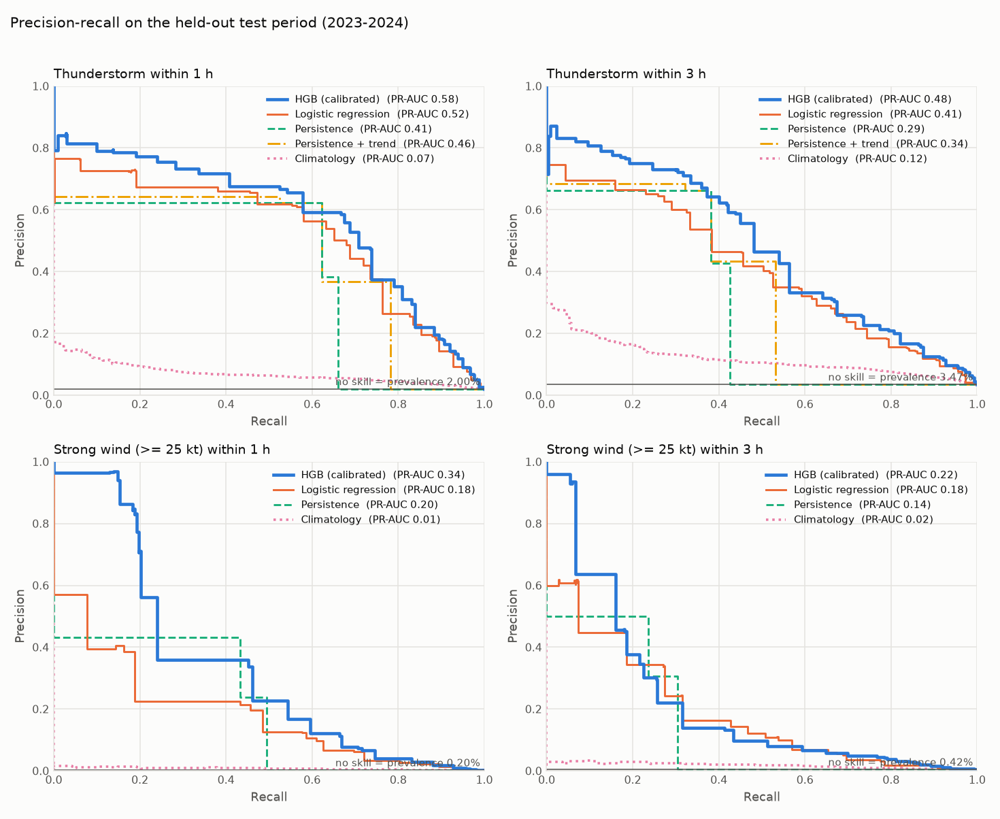
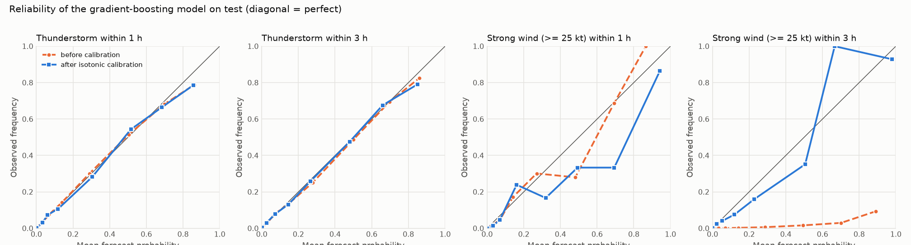

# AirfieldShield - model evaluation report

> Generated by `python -m ai_models.ml.train`; do not edit by hand. Run at 2026-11-17T05:52:22+00:00 (code commit `4e3023c`, seed 42).

All numbers below are computed on **real archived METAR observations**; no synthetic data is used anywhere in training or evaluation.

## 1. Data

- Source: Iowa Environmental Mesonet ASOS/METAR archive (public, no API key), routine + special reports.
- Period: 2016-01-01 to 2024-12-31 (UTC), aggregated to hourly buckets `(h-1h, h]`.
- File: `data/metar_hourly.csv.gz`, sha256 `2bf07d2a2b7598ee...`, 470,057 station-hours with at least one report.
- Hazards: *thunderstorm* = TS/VCTS present-weather group in the observation body of any report; *strong wind* = sustained wind or gust >= 25 kt.

| Station | Airfield | Hours | Report coverage | TS hours | Strong-wind hours (>=25 kt) | Gale hours (>=34 kt) |
|---|---|---:|---:|---:|---:|---:|
| VAAH | Ahmedabad Sardar Vallabhbhai Patel Intl | 78,912 | 98.2% | 561 | 61 | 9 |
| VABB | Mumbai Chhatrapati Shivaji Maharaj Intl | 78,912 | 99.6% | 1,255 | 315 | 12 |
| VECC | Kolkata Netaji Subhas Chandra Bose Intl | 78,912 | 99.8% | 2,869 | 106 | 27 |
| VIDP | Delhi Indira Gandhi Intl | 78,912 | 98.7% | 1,576 | 154 | 26 |
| VOBL | Bengaluru Kempegowda Intl | 78,912 | 99.7% | 1,182 | 257 | 38 |
| VOMM | Chennai Intl | 78,912 | 99.7% | 1,905 | 124 | 43 |

Quality control. Indian METARs are typed by hand and contain typos such as `070064KT` or `09006G46KT` in fog. Each rule below uses only the report itself and the previous report, so the same procedure runs at serving time. Flagged values are set to missing, not dropped. Counts are individual reports:

| Station | Reports | malformed wind group | wind out of range | gust out of range | implausible gust factor | isolated wind spike | temp c out of range | dewpoint c out of range | pressure hpa out of range | temp jump | dewpoint above temp |
|---|---:|---:|---:|---:|---:|---:|---:|---:|---:|---:|---:|
| VIDP | 154,088 | 139 | 6 | 0 | 1 | 3 | 1 | 0 | 3 | 12 | 0 |
| VABB | 156,631 | 62 | 1 | 0 | 0 | 2 | 0 | 0 | 2 | 0 | 0 |
| VOMM | 155,650 | 15 | 1 | 0 | 0 | 0 | 0 | 0 | 5 | 0 | 0 |
| VECC | 157,932 | 137 | 6 | 0 | 0 | 7 | 0 | 0 | 1,568 | 0 | 0 |
| VOBL | 158,409 | 182 | 0 | 57 | 87 | 4 | 1 | 0 | 17 | 3 | 0 |
| VAAH | 152,050 | 373 | 1 | 0 | 0 | 8 | 0 | 0 | 29 | 3 | 0 |

True gale-force wind (>= 34 kt) is too rare at these airfields to train or evaluate a classifier (see last column), so the wind hazard is defined at 25 kt.

## 2. Protocol

- Chronological split: train `< 2022-01-01`, validation `2022-01-01 .. 2023-01-01`, test `>= 2023-01-01`. Rows whose label window crosses a boundary are purged.
- Features at hour `h` use only reports valid at or before `h`; labels cover `(h, h+H]`. A label is 0 only if every hour of the window has a report, otherwise the row is dropped.
- Validation year is used for boosting-iteration selection, class-weight selection, isotonic calibration and alert thresholds. Test years are used once, for this report.
- 95% confidence intervals: percentile bootstrap resampling whole station-days (hourly samples are autocorrelated), paired across methods.
- Metrics: PR-AUC (average precision), ROC-AUC, Brier score, Brier skill score (BSS) relative to climatology, expected calibration error (ECE, 10 equal-mass bins).

## 3. Results on the held-out test period

### 3.1 Thunderstorm within 1 h (`thunder_1h`)

Samples (positives): train 311,381 (6,204), validation 52,377 (1,009), test 104,815 (2,095); test prevalence 2.00%.

| Method | PR-AUC | 95% CI | ROC-AUC | Brier | BSS vs clim. | ECE |
|---|---:|---:|---:|---:|---:|---:|
| Base rate (constant) | 0.020 | [0.018, 0.022] | 0.500 | 0.0196 | -0.026 | 0.0073 |
| Climatology (station x month x 3h) | 0.070 | [0.064, 0.083] | 0.784 | 0.0191 | 0.000 | 0.0043 |
| Persistence | 0.409 | [0.387, 0.431] | 0.824 | 0.0122 | 0.363 | 0.0025 |
| Persistence + METAR trend | 0.461 | [0.437, 0.483] | 0.883 | 0.0118 | 0.384 | 0.0012 |
| Logistic regression | 0.525 | [0.503, 0.547] | 0.965 | 0.0120 | 0.373 | 0.0017 |
| **HistGradientBoosting (calibrated)** | **0.576** | [0.555, 0.601] | 0.969 | 0.0112 | 0.413 | 0.0012 |
| HistGradientBoosting (uncalibrated) | 0.593 | [0.572, 0.619] | 0.971 | 0.0112 | 0.416 | 0.0005 |
| HGB without trend_ts (ablation) | 0.566 | [0.541, 0.592] | 0.968 | 0.0114 | 0.401 | 0.0010 |

Paired bootstrap, calibrated HGB minus other method (PR-AUC difference > 0 and Brier difference < 0 favour HGB; an interval containing 0 is not significant):

| Compared with | PR-AUC diff 95% CI | Brier diff 95% CI |
|---|---:|---:|
| Base rate (constant) | [0.536, 0.581] | [-0.00942, -0.00729] |
| Climatology (station x month x 3h) | [0.486, 0.528] | [-0.00881, -0.00689] |
| Persistence | [0.151, 0.181] | [-0.00116, -0.00074] |
| Persistence + METAR trend | [0.102, 0.128] | [-0.00071, -0.00037] |
| Logistic regression | [0.038, 0.063] | [-0.00093, -0.00059] |
| HistGradientBoosting (uncalibrated) | [-0.019, -0.014] | [0.00001, 0.00009] |
| HGB without trend_ts (ablation) | [0.004, 0.017] | [-0.00034, -0.00012] |

Operating points (threshold chosen on validation to reach a precision target with maximum recall, then applied unchanged to test). These thresholds drive the alert levels YELLOW / ORANGE / RED.

| Precision target (val) | Threshold | Val precision | Val recall | Test precision | Test recall | Test alerts |
|---:|---:|---:|---:|---:|---:|---:|
| 0.25 | 0.042 | 0.308 | 0.844 | 0.294 | 0.840 | 5,980 |
| 0.50 | 0.118 | 0.511 | 0.746 | 0.472 | 0.737 | 3,272 |
| 0.75 | 0.643 | 0.759 | 0.436 | 0.716 | 0.408 | 1,192 |

Onset-only subset (hazard absent now and during the previous 3 h; 101,195 rows, 710 positives, prevalence 0.70%) - the harder and operationally more valuable case, where persistence carries no information:

| Method | PR-AUC (onset only) |
|---|---:|
| Base rate (constant) | 0.007 |
| Climatology (station x month x 3h) | 0.027 |
| Persistence | 0.007 |
| Persistence + METAR trend | 0.070 |
| Logistic regression | 0.114 |
| HistGradientBoosting (calibrated) | 0.163 |
| HistGradientBoosting (uncalibrated) | 0.175 |
| HGB without trend_ts (ablation) | 0.123 |

Per station (calibrated HGB; stations with < 5 test positives omitted):

| Station | Test rows | Positives | PR-AUC | ROC-AUC | Brier | BSS vs clim. |
|---|---:|---:|---:|---:|---:|---:|
| VAAH | 17,462 | 199 | 0.554 | 0.966 | 0.0066 | 0.405 |
| VABB | 17,377 | 237 | 0.643 | 0.968 | 0.0068 | 0.482 |
| VECC | 17,539 | 641 | 0.590 | 0.964 | 0.0197 | 0.420 |
| VIDP | 17,419 | 458 | 0.587 | 0.971 | 0.0149 | 0.414 |
| VOBL | 17,508 | 192 | 0.563 | 0.972 | 0.0063 | 0.403 |
| VOMM | 17,510 | 368 | 0.536 | 0.965 | 0.0128 | 0.365 |

Class-imbalance handling (selected on validation PR-AUC): `class_weight=None` -> val PR-AUC 0.637 at 260 iterations; `class_weight=balanced` -> val PR-AUC 0.627 at 230 iterations. Chosen: `None`. Probabilities are re-calibrated with isotonic regression on validation in either case.

Top-10 permutation importances (drop in test PR-AUC, mean +/- sd of 3 repeats): `ts` 0.199+/-0.001, `cb` 0.059+/-0.006, `trend_ts` 0.034+/-0.002, `cb_sum6h` 0.017+/-0.004, `pressure_d1h` 0.014+/-0.003, `doy_cos` 0.011+/-0.002, `solar_hour_cos` 0.010+/-0.003, `solar_hour_sin` 0.008+/-0.001, `dewpoint_c` 0.008+/-0.003, `doy_sin` 0.007+/-0.001.

Reliability of the calibrated model on test:

| Forecast bin | n | Mean forecast | Observed frequency |
|---|---:|---:|---:|
| 0.00-0.02 | 94,267 | 0.002 | 0.002 |
| 0.02-0.05 | 4,937 | 0.034 | 0.032 |
| 0.05-0.10 | 1,184 | 0.061 | 0.073 |
| 0.10-0.20 | 1,617 | 0.118 | 0.106 |
| 0.20-0.40 | 959 | 0.306 | 0.283 |
| 0.40-0.60 | 657 | 0.515 | 0.543 |
| 0.60-0.80 | 686 | 0.685 | 0.665 |
| 0.80-1.00 | 508 | 0.856 | 0.785 |

### 3.2 Thunderstorm within 3 h (`thunder_3h`)

Samples (positives): train 309,110 (10,596), validation 52,304 (1,726), test 104,550 (3,627); test prevalence 3.47%.

| Method | PR-AUC | 95% CI | ROC-AUC | Brier | BSS vs clim. | ECE |
|---|---:|---:|---:|---:|---:|---:|
| Base rate (constant) | 0.035 | [0.032, 0.038] | 0.500 | 0.0335 | -0.046 | 0.0126 |
| Climatology (station x month x 3h) | 0.119 | [0.109, 0.135] | 0.786 | 0.0320 | 0.000 | 0.0061 |
| Persistence | 0.291 | [0.272, 0.315] | 0.705 | 0.0254 | 0.208 | 0.0076 |
| Persistence + METAR trend | 0.341 | [0.321, 0.362] | 0.757 | 0.0244 | 0.237 | 0.0053 |
| Logistic regression | 0.410 | [0.388, 0.434] | 0.916 | 0.0248 | 0.225 | 0.0025 |
| **HistGradientBoosting (calibrated)** | **0.480** | [0.461, 0.505] | 0.932 | 0.0230 | 0.281 | 0.0026 |
| HistGradientBoosting (uncalibrated) | 0.494 | [0.475, 0.520] | 0.933 | 0.0229 | 0.283 | 0.0024 |
| HGB without trend_ts (ablation) | 0.474 | [0.453, 0.499] | 0.931 | 0.0232 | 0.274 | 0.0030 |

Paired bootstrap, calibrated HGB minus other method (PR-AUC difference > 0 and Brier difference < 0 favour HGB; an interval containing 0 is not significant):

| Compared with | PR-AUC diff 95% CI | Brier diff 95% CI |
|---|---:|---:|
| Base rate (constant) | [0.427, 0.468] | [-0.01176, -0.00939] |
| Climatology (station x month x 3h) | [0.339, 0.386] | [-0.01005, -0.00801] |
| Persistence | [0.173, 0.202] | [-0.00278, -0.00187] |
| Persistence + METAR trend | [0.127, 0.149] | [-0.00173, -0.00106] |
| Logistic regression | [0.058, 0.083] | [-0.00219, -0.00147] |
| HistGradientBoosting (uncalibrated) | [-0.016, -0.013] | [0.00001, 0.00008] |
| HGB without trend_ts (ablation) | [0.002, 0.011] | [-0.00036, -0.00012] |

Operating points (threshold chosen on validation to reach a precision target with maximum recall, then applied unchanged to test). These thresholds drive the alert levels YELLOW / ORANGE / RED.

| Precision target (val) | Threshold | Val precision | Val recall | Test precision | Test recall | Test alerts |
|---:|---:|---:|---:|---:|---:|---:|
| 0.25 | 0.083 | 0.259 | 0.769 | 0.255 | 0.735 | 10,453 |
| 0.50 | 0.259 | 0.575 | 0.492 | 0.556 | 0.481 | 3,134 |
| 0.75 | 0.583 | 0.752 | 0.323 | 0.730 | 0.304 | 1,509 |

Onset-only subset (hazard absent now and during the previous 3 h; 100,930 rows, 2,085 positives, prevalence 2.07%) - the harder and operationally more valuable case, where persistence carries no information:

| Method | PR-AUC (onset only) |
|---|---:|
| Base rate (constant) | 0.021 |
| Climatology (station x month x 3h) | 0.081 |
| Persistence | 0.021 |
| Persistence + METAR trend | 0.074 |
| Logistic regression | 0.146 |
| HistGradientBoosting (calibrated) | 0.194 |
| HistGradientBoosting (uncalibrated) | 0.206 |
| HGB without trend_ts (ablation) | 0.177 |

Per station (calibrated HGB; stations with < 5 test positives omitted):

| Station | Test rows | Positives | PR-AUC | ROC-AUC | Brier | BSS vs clim. |
|---|---:|---:|---:|---:|---:|---:|
| VAAH | 17,409 | 342 | 0.438 | 0.932 | 0.0138 | 0.269 |
| VABB | 17,280 | 380 | 0.559 | 0.938 | 0.0130 | 0.377 |
| VECC | 17,533 | 1,102 | 0.506 | 0.916 | 0.0400 | 0.272 |
| VIDP | 17,351 | 804 | 0.491 | 0.922 | 0.0308 | 0.293 |
| VOBL | 17,490 | 332 | 0.476 | 0.957 | 0.0128 | 0.295 |
| VOMM | 17,487 | 667 | 0.433 | 0.918 | 0.0274 | 0.226 |

Class-imbalance handling (selected on validation PR-AUC): `class_weight=None` -> val PR-AUC 0.534 at 300 iterations; `class_weight=balanced` -> val PR-AUC 0.523 at 160 iterations. Chosen: `None`. Probabilities are re-calibrated with isotonic regression on validation in either case.

Top-10 permutation importances (drop in test PR-AUC, mean +/- sd of 3 repeats): `cb` 0.123+/-0.006, `ts` 0.078+/-0.006, `trend_ts` 0.023+/-0.002, `hours_since_ts` 0.015+/-0.003, `doy_cos` 0.011+/-0.001, `dewpoint_c` 0.011+/-0.001, `doy_sin` 0.008+/-0.001, `solar_hour_sin` 0.008+/-0.001, `solar_hour_cos` 0.007+/-0.002, `cb_sum6h` 0.007+/-0.002.

Reliability of the calibrated model on test:

| Forecast bin | n | Mean forecast | Observed frequency |
|---|---:|---:|---:|
| 0.00-0.02 | 78,273 | 0.002 | 0.004 |
| 0.02-0.05 | 11,343 | 0.026 | 0.030 |
| 0.05-0.10 | 7,340 | 0.073 | 0.079 |
| 0.10-0.20 | 3,389 | 0.145 | 0.131 |
| 0.20-0.40 | 1,948 | 0.265 | 0.258 |
| 0.40-0.60 | 764 | 0.479 | 0.475 |
| 0.60-0.80 | 796 | 0.660 | 0.676 |
| 0.80-1.00 | 697 | 0.850 | 0.791 |

### 3.3 Strong wind (>= 25 kt) within 1 h (`wind_1h`)

Samples (positives): train 311,224 (694), validation 52,369 (112), test 104,798 (208); test prevalence 0.20%.

| Method | PR-AUC | 95% CI | ROC-AUC | Brier | BSS vs clim. | ECE |
|---|---:|---:|---:|---:|---:|---:|
| Base rate (constant) | 0.002 | [0.001, 0.003] | 0.500 | 0.0020 | 0.002 | 0.0015 |
| Climatology (station x month x 3h) | 0.008 | [0.005, 0.013] | 0.779 | 0.0020 | 0.000 | 0.0015 |
| Persistence | 0.203 | [0.082, 0.312] | 0.746 | 0.0017 | 0.158 | 0.0011 |
| Logistic regression | 0.183 | [0.082, 0.278] | 0.960 | 0.0018 | 0.111 | 0.0004 |
| **HistGradientBoosting (calibrated)** | **0.337** | [0.118, 0.478] | 0.962 | 0.0015 | 0.226 | 0.0005 |
| HistGradientBoosting (uncalibrated) | 0.378 | [0.130, 0.521] | 0.964 | 0.0015 | 0.235 | 0.0003 |

Paired bootstrap, calibrated HGB minus other method (PR-AUC difference > 0 and Brier difference < 0 favour HGB; an interval containing 0 is not significant):

| Compared with | PR-AUC diff 95% CI | Brier diff 95% CI |
|---|---:|---:|
| Base rate (constant) | [0.116, 0.476] | [-0.00080, -0.00010] |
| Climatology (station x month x 3h) | [0.112, 0.470] | [-0.00080, -0.00011] |
| Persistence | [0.013, 0.215] | [-0.00038, 0.00008] |
| Logistic regression | [0.024, 0.229] | [-0.00044, -0.00002] |
| HistGradientBoosting (uncalibrated) | [-0.056, -0.013] | [-0.00003, 0.00008] |

Operating points (threshold chosen on validation to reach a precision target with maximum recall, then applied unchanged to test). These thresholds drive the alert levels YELLOW / ORANGE / RED.

| Precision target (val) | Threshold | Val precision | Val recall | Test precision | Test recall | Test alerts |
|---:|---:|---:|---:|---:|---:|---:|
| 0.25 | 0.194 | 0.396 | 0.188 | 0.562 | 0.240 | 89 |
| 0.50 | 0.333 | 0.682 | 0.134 | 0.719 | 0.197 | 57 |
| 0.75 | n/a | n/a | 0.000 | n/a | 0.000 | 0 |

Onset-only subset (hazard absent now and during the previous 3 h; 104,366 rows, 105 positives, prevalence 0.10%) - the harder and operationally more valuable case, where persistence carries no information:

| Method | PR-AUC (onset only) |
|---|---:|
| Base rate (constant) | 0.001 |
| Climatology (station x month x 3h) | 0.005 |
| Persistence | 0.001 |
| Logistic regression | 0.021 |
| HistGradientBoosting (calibrated) | 0.033 |
| HistGradientBoosting (uncalibrated) | 0.038 |

Per station (calibrated HGB; stations with < 5 test positives omitted):

| Station | Test rows | Positives | PR-AUC | ROC-AUC | Brier | BSS vs clim. |
|---|---:|---:|---:|---:|---:|---:|
| VAAH | 17,454 | 50 | 0.426 | 0.946 | 0.0023 | 0.186 |
| VABB | 17,376 | 60 | 0.091 | 0.952 | 0.0033 | 0.044 |
| VECC | 17,532 | 36 | 0.501 | 0.971 | 0.0014 | 0.314 |
| VIDP | 17,418 | 25 | 0.052 | 0.965 | 0.0014 | 0.003 |
| VOMM | 17,510 | 34 | 0.863 | 0.995 | 0.0005 | 0.751 |

Class-imbalance handling (selected on validation PR-AUC): `class_weight=None` -> val PR-AUC 0.246 at 70 iterations; `class_weight=balanced` -> val PR-AUC 0.227 at 200 iterations. Chosen: `None`. Probabilities are re-calibrated with isotonic regression on validation in either case.

Top-10 permutation importances (drop in test PR-AUC, mean +/- sd of 3 repeats): `peak_wind_ms` 0.330+/-0.006, `peak_wind_max6h` 0.310+/-0.003, `peak_wind_max3h` 0.049+/-0.005, `pressure_hpa` 0.021+/-0.009, `wind_v` 0.014+/-0.003, `gust_ms` 0.014+/-0.000, `strong_wind_sum6h` 0.013+/-0.000, `wind_ms` 0.010+/-0.003, `doy_cos` 0.008+/-0.004, `pressure_d3h` 0.006+/-0.002.

Reliability of the calibrated model on test:

| Forecast bin | n | Mean forecast | Observed frequency |
|---|---:|---:|---:|
| 0.00-0.02 | 102,470 | 0.001 | 0.001 |
| 0.02-0.05 | 1,092 | 0.031 | 0.015 |
| 0.05-0.10 | 951 | 0.069 | 0.045 |
| 0.10-0.20 | 226 | 0.161 | 0.239 |
| 0.20-0.40 | 6 | 0.319 | 0.167 |
| 0.40-0.60 | 6 | 0.493 | 0.333 |
| 0.60-0.80 | 3 | 0.694 | 0.333 |
| 0.80-1.00 | 44 | 0.942 | 0.864 |

### 3.4 Strong wind (>= 25 kt) within 3 h (`wind_3h`)

Samples (positives): train 308,955 (1,695), validation 52,302 (276), test 104,542 (435); test prevalence 0.42%.

| Method | PR-AUC | 95% CI | ROC-AUC | Brier | BSS vs clim. | ECE |
|---|---:|---:|---:|---:|---:|---:|
| Base rate (constant) | 0.004 | [0.003, 0.005] | 0.500 | 0.0041 | 0.007 | 0.0032 |
| Climatology (station x month x 3h) | 0.018 | [0.012, 0.026] | 0.797 | 0.0042 | 0.000 | 0.0032 |
| Persistence | 0.142 | [0.062, 0.215] | 0.650 | 0.0037 | 0.120 | 0.0024 |
| Logistic regression | 0.184 | [0.098, 0.254] | 0.925 | 0.0037 | 0.111 | 0.0020 |
| **HistGradientBoosting (calibrated)** | **0.218** | [0.104, 0.300] | 0.933 | 0.0036 | 0.134 | 0.0014 |
| HistGradientBoosting (uncalibrated) | 0.247 | [0.119, 0.339] | 0.935 | 0.0405 | -8.704 | 0.0795 |

Paired bootstrap, calibrated HGB minus other method (PR-AUC difference > 0 and Brier difference < 0 favour HGB; an interval containing 0 is not significant):

| Compared with | PR-AUC diff 95% CI | Brier diff 95% CI |
|---|---:|---:|
| Base rate (constant) | [0.101, 0.296] | [-0.00088, -0.00008] |
| Climatology (station x month x 3h) | [0.087, 0.281] | [-0.00088, -0.00015] |
| Persistence | [0.028, 0.115] | [-0.00022, 0.00014] |
| Logistic regression | [-0.008, 0.070] | [-0.00025, 0.00007] |
| HistGradientBoosting (uncalibrated) | [-0.041, -0.015] | [-0.03955, -0.03447] |

Operating points (threshold chosen on validation to reach a precision target with maximum recall, then applied unchanged to test). These thresholds drive the alert levels YELLOW / ORANGE / RED.

| Precision target (val) | Threshold | Val precision | Val recall | Test precision | Test recall | Test alerts |
|---:|---:|---:|---:|---:|---:|---:|
| 0.25 | 0.168 | 0.310 | 0.377 | 0.221 | 0.315 | 619 |
| 0.50 | 0.400 | 0.551 | 0.214 | 0.453 | 0.186 | 179 |
| 0.75 | n/a | n/a | 0.000 | n/a | 0.000 | 0 |

Onset-only subset (hazard absent now and during the previous 3 h; 104,112 rows, 303 positives, prevalence 0.29%) - the harder and operationally more valuable case, where persistence carries no information:

| Method | PR-AUC (onset only) |
|---|---:|
| Base rate (constant) | 0.003 |
| Climatology (station x month x 3h) | 0.015 |
| Persistence | 0.003 |
| Logistic regression | 0.043 |
| HistGradientBoosting (calibrated) | 0.039 |
| HistGradientBoosting (uncalibrated) | 0.042 |

Per station (calibrated HGB; stations with < 5 test positives omitted):

| Station | Test rows | Positives | PR-AUC | ROC-AUC | Brier | BSS vs clim. |
|---|---:|---:|---:|---:|---:|---:|
| VAAH | 17,409 | 89 | 0.485 | 0.948 | 0.0038 | 0.251 |
| VABB | 17,277 | 152 | 0.166 | 0.940 | 0.0079 | 0.072 |
| VECC | 17,533 | 70 | 0.345 | 0.921 | 0.0031 | 0.210 |
| VIDP | 17,347 | 69 | 0.088 | 0.922 | 0.0038 | 0.051 |
| VOBL | 17,490 | 9 | 0.004 | 0.927 | 0.0018 | -0.806 |
| VOMM | 17,486 | 46 | 0.638 | 0.971 | 0.0013 | 0.484 |

Class-imbalance handling (selected on validation PR-AUC): `class_weight=None` -> val PR-AUC 0.250 at 90 iterations; `class_weight=balanced` -> val PR-AUC 0.291 at 210 iterations. Chosen: `balanced`. Probabilities are re-calibrated with isotonic regression on validation in either case.

Top-10 permutation importances (drop in test PR-AUC, mean +/- sd of 3 repeats): `peak_wind_ms` 0.177+/-0.003, `peak_wind_max3h` 0.162+/-0.007, `strong_wind_sum6h` 0.054+/-0.001, `pressure_hpa` 0.035+/-0.006, `doy_cos` 0.034+/-0.010, `peak_wind_max6h` 0.032+/-0.007, `wind_ms` 0.025+/-0.004, `solar_hour_sin` 0.014+/-0.005, `doy_sin` 0.014+/-0.010, `gust_ms` 0.013+/-0.003.

Reliability of the calibrated model on test:

| Forecast bin | n | Mean forecast | Observed frequency |
|---|---:|---:|---:|
| 0.00-0.02 | 99,351 | 0.001 | 0.001 |
| 0.02-0.05 | 1,976 | 0.024 | 0.023 |
| 0.05-0.10 | 1,927 | 0.053 | 0.040 |
| 0.10-0.20 | 921 | 0.119 | 0.075 |
| 0.20-0.40 | 188 | 0.227 | 0.160 |
| 0.40-0.60 | 148 | 0.506 | 0.351 |
| 0.60-0.80 | 3 | 0.667 | 1.000 |
| 0.80-1.00 | 28 | 0.979 | 0.929 |

## 4. Figures

## 5. Environment

python 3.12.10, scikit-learn 1.9.1, numpy 2.5.5, pandas 3.1.1.
